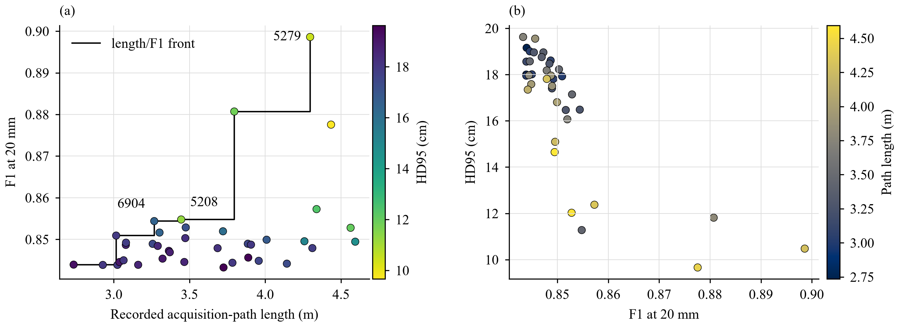

<div align="center">

# Trajectory Design for Sparse Eye-in-Hand 3D Reconstruction of a Known Workcell

Which scan should a wrist-mounted camera drive when the cell is known in advance?<br>
Pipeline code, result tables and the complete analysis of a 10,000-configuration simulation study.

[](https://github.com/Adam-yes/trajectory-design-for-sparse-eye-in-hand-reconstruction/actions/workflows/tests.yml)
[](pyproject.toml)
[](integrations/)
[](docs/VALIDATION.md)

<picture>
  <source media="(prefers-color-scheme: dark)" srcset="assets/overview-dark.png">
  
</picture>

</div>

---

## At a glance

| | |
|---|---|
| **Problem** | A camera on a robot wrist can only scan from poses the arm reaches without collision. For a cell with a known model, one scan is planned once and repeated many times. Which one should be stored? |
| **Approach** | Search a six-parameter ellipsoidal scan family on a 10,000-configuration grid, execute every candidate in a simulated UR5e cell with MoveIt 2, reconstruct the admitted scans with VGGT, register them to the reference with BUFFER-X, and score the geometry. |
| **Outcome** | 4.32% of the grid is executable. One additional context image raises the median F1 from 0.49 to 0.79. The vertical radius of the scan decides whether a scan lands in the top decile. A threshold rule on F1 and HD95 picks the shortest scan that meets a stated requirement. |
| **Evidence** | Every table and figure of the article is regenerated from the bundled result tables by one command, in about a minute, on a laptop. 103 automated tests, including tests that pin the published numbers. |
| **Limits** | Simulation only, one scene, one execution per configuration. Stated in full [below](#scope-and-limits). |

## Key results

| Finding | Value | Where |
|---|---|---|
| Grid configurations admitted by the planner | 432 of 10,000 (4.32%) | [Results §1](docs/RESULTS.md#1-execution-feasibility) |
| Recorded configurations with horizontal radius above 0.22 m or upper polar limit of 80° | none | [Results §1](docs/RESULTS.md#1-execution-feasibility) |
| Median F1 at 20 mm, without and with the context image | 0.49 → 0.79 | [Results §2](docs/RESULTS.md#2-effect-of-the-pipeline-settings) |
| Top-decile precision, without and with the context image | 0.71 → 0.99 | [Results §2](docs/RESULTS.md#2-effect-of-the-pipeline-settings) |
| Top-decile recall with the context image (the limiting factor) | 0.74 | [Results §2](docs/RESULTS.md#2-effect-of-the-pipeline-settings) |
| Separation of top and bottom F1 decile by vertical radius (Cliff's δ) | above 0.99 | [Results §3](docs/RESULTS.md#3-scan-parameters-of-the-top-and-bottom-decile) |
| Non-dominated scans in path length and F1 above the 90th percentile | 6 of 38 | [Results §4](docs/RESULTS.md#4-path-length-and-quality) |
| Spread of HD95 among scans whose F1 differs by less than 0.02 | 11.3 to 19.6 cm | [Results §4](docs/RESULTS.md#4-path-length-and-quality) |

<p align="center">
  
</p>

## Reproduce the results

No GPU, no simulator, no network access during the run.

```bash
git clone https://github.com/Adam-yes/trajectory-design-for-sparse-eye-in-hand-reconstruction
cd trajectory-design-for-sparse-eye-in-hand-reconstruction/study
bash run_all.sh        # Windows: run_all.bat
```

The script creates a virtual environment, installs the pinned requirements, recomputes
the statistics, executes the plotting notebook and writes the LaTeX tables. Output goes
to `study/results/` and `study/plots/out/`. Details: [`study/README.md`](study/README.md).

## What is in this repository

| Path | Content | Verified by |
|---|---|---|
| [`study/`](study/) | Result tables of the study, the analysis, the plotting notebook, generated figures and tables | Tests that rerun the analysis and compare with the published values; CI executes the full run |
| [`src/eyeinhand/`](src/eyeinhand/) | Python package: scan family, frame preparation, registration composition, metrics, operating-point selection, command-line interface | 93 analytic and synthetic unit tests |
| [`integrations/`](integrations/) | ROS 2 planning-scene and capture adapters, isolated BUFFER-X worker | Source-checked; not executed in CI (need ROS 2, MoveIt 2, GPU) |
| [`configs/`](configs/) | Metric configuration and the collision scene of the simulated cell | Configuration tests |
| [`docs/`](docs/) | [Results](docs/RESULTS.md), [workflow](docs/WORKFLOW.md), [data contracts](docs/CONTRACTS.md), [validation record](docs/VALIDATION.md) | |
| [`tests/`](tests/) | Test suite | `pytest`, `ruff` in CI |

## Method in brief

**Scan family.** A scan is six numbers: two ellipsoid radii, two azimuth limits and two
polar limits. Camera positions follow

```
p(φ, θ) = c + [ r_xy·sinθ·cosφ ,  r_xy·sinθ·sinφ ,  r_z·cosθ ]
```

with the camera pointing at the focal target `c` and the direction of travel alternating
on successive azimuth slices. Because `r_xy ≠ r_z`, the polar parameter `θ` differs from
the inclination of the sightline, `β = arctan((r_xy / r_z)·tanθ)`. The code keeps the two
apart.

**Stages.** Each configuration is planned against a collision model of the cell and the
wrist assembly. A scan is admitted when more than 75% of its path executes. Admitted
image sets go to VGGT, optionally preceded by a fixed top-down context image. The output
is registered to the reference geometry with an optional oriented-bounding-box
initialization and two BUFFER-X passes.

**Measures.** Precision, recall and F1 at 20 mm, a cloud-to-mesh distance, the two
directional Chamfer terms, a 95th-percentile Hausdorff distance (HD95) and the recorded
wrist-path length. With the context image, HD95 is set by reference surface that the
reconstruction does not cover, so it measures the extent of coverage gaps.

**Selection.** The shortest scan that satisfies a lower bound on F1 and an upper bound
on HD95:

```python
from eyeinhand.operating_points import load_runs, select_operating_point, RUN_COLUMNS

rows = load_runs("runs/summary.csv", RUN_COLUMNS)
best = select_operating_point(rows, min_f1=0.85, max_hd95_m=0.12)
```

## Using the pipeline on your own cell

```bash
python -m venv .venv && . .venv/bin/activate
python -m pip install -e '.[analysis]'
eyeinhand doctor                      # reports which optional backends are available
eyeinhand demo --output runs/demo.json   # end-to-end synthetic run, CPU only
```

The core needs NumPy, SciPy and Pillow. Optional extras add Open3D and trimesh
(`geometry`), PyTorch (`inference`) and the test tools (`dev`). ROS 2, MoveIt 2, Isaac
Sim, VGGT and BUFFER-X are external systems. They are imported lazily and are not
bundled. The full path from a scan proposal to a selected run is described in
[`docs/WORKFLOW.md`](docs/WORKFLOW.md).

| Stage | Entry point | Requires |
|---|---|---|
| Scan family and grid enumeration | `eyeinhand.trajectory` | core |
| Collision scene | `integrations/ros2_scene.py` | ROS 2, MoveIt 2 |
| Image capture | `integrations/ros2_capture.py` | ROS 2 |
| Frame preparation, masking, budget | `eyeinhand prepare-study` | core |
| Reconstruction | `eyeinhand reconstruct` | VGGT, PyTorch |
| Registration | `eyeinhand register` | BUFFER-X worker, Open3D |
| Evaluation | `eyeinhand evaluate` | trimesh or Open3D |
| Operating-point selection | `eyeinhand.operating_points` | core |

## Quality

```bash
python -m pip install -e '.[dev,analysis]' trimesh
python -m pytest -q        # 103 tests
python -m ruff check .
```

- The package tests use analytic and synthetic fixtures. They cover geometry, metrics,
  file protocols, the registration composition and the selection rules.
- The study tests rerun the analysis on the bundled tables and compare the outcome with
  the numbers in the article.
- CI runs both, and executes the full study including the plotting notebook.
- [`docs/VALIDATION.md`](docs/VALIDATION.md) records what was executed and which
  runtimes were never exercised.

## Scope and limits

- **Simulation.** All images are rendered. No sensor noise, no calibration error, simple
  materials and lighting. No physical robot was run.
- **One cell, one scene.** The executable share of the grid is a property of this arm,
  tool and frame. The scene is a table with geometric primitives.
- **One execution per configuration.** Run-to-run variation is not measured.
- **Stored records.** Complete metric records exist for the top, middle and bottom F1
  decile of each setting (38 runs each). The 10th and 90th percentiles are exact;
  statements about runs between the stored deciles are not made.
- **No comparison with next-best-view planners.** Those methods plan online for unknown
  objects. This study concerns a stored scan for a known cell.
- **Integration code.** The ROS 2 adapters and the BUFFER-X worker are not exercised by
  the automated tests.
- **Not a safety controller.** See [`SECURITY.md`](SECURITY.md).

## Status

| | |
|---|---|
| Version | 0.4.0, see [`CHANGELOG.md`](CHANGELOG.md) |
| Article | Under review. Citation details are added here on publication. |
| License | Not yet assigned. Until the rights holders choose one, no reuse rights are granted. See [`THIRD_PARTY_NOTICES.md`](THIRD_PARTY_NOTICES.md). |
| Contributions | [`CONTRIBUTING.md`](CONTRIBUTING.md) |
