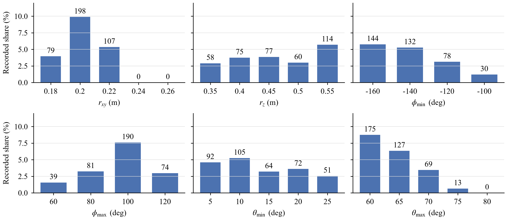
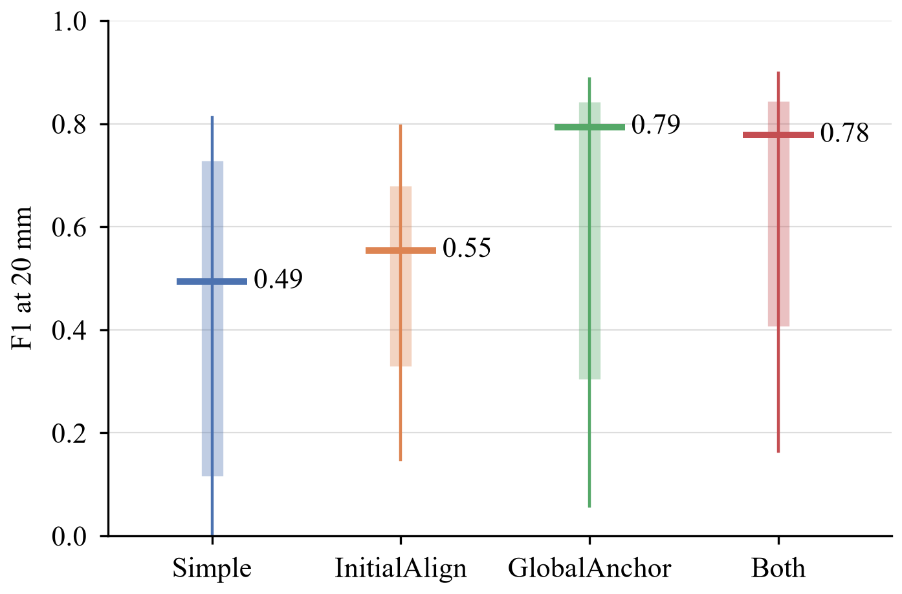
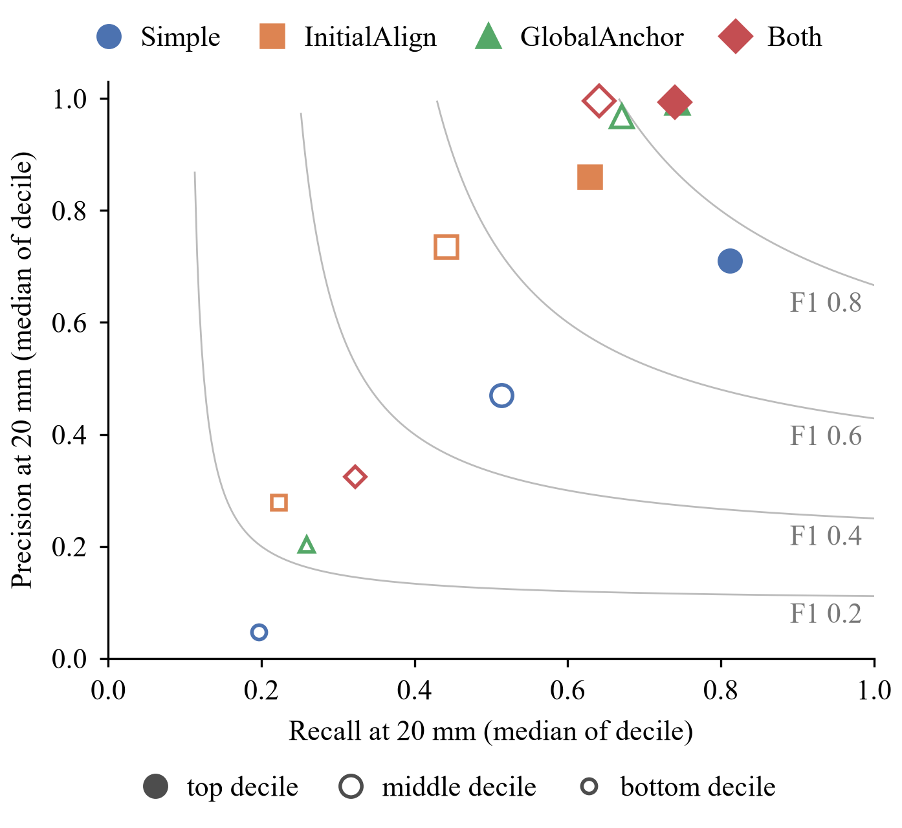
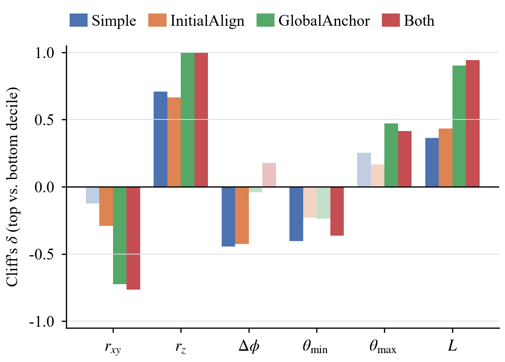
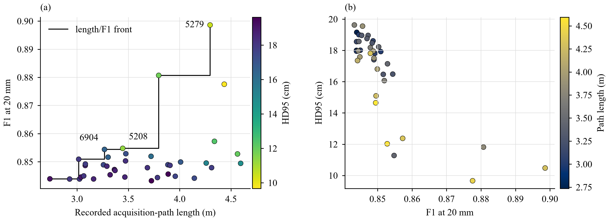

# Results of the study

Summary of the findings reported in the article. Every number on this page is produced
by [`study/analysis.py`](../study/analysis.py) from the tables in
[`study/data/`](../study/data/), and every figure by
[`study/plots/make_plots.ipynb`](../study/plots/make_plots.ipynb).

## Setup

- Simulated UR5e cell with a wrist camera and gripper, table, frame, and geometric
  primitives on the table (NVIDIA Isaac Sim, ROS 2, MoveIt 2).
- Six-parameter ellipsoidal lawnmower scan, 10,000 grid configurations, at most 20 images
  per scan.
- Reconstruction with VGGT, registration to the reference geometry with BUFFER-X.
- Four pipeline settings:

| Setting | Abbr. | Context image | Bounding-box initialization |
|---|---|---|---|
| Simple | S | no | no |
| InitialAlign | I | no | yes |
| GlobalAnchor | G | yes | no |
| Both | B | yes | yes |

## What the stored tables contain

| Set | Size |
|---|---|
| Grid configurations | 10,000 |
| Admitted by the completion threshold | 432 |
| Below the completion threshold | 7,822 |
| Planner or simulator error | 1,746 |
| Evaluated reconstructions per setting | 380 to 389 |
| Runs per stored decile | 38 |
| Runs with complete record per setting | 114 |
| Distinct configurations with complete record | 279 |
| Distinct configurations in any stored table ("recorded configurations") | 384 |

Complete metric records exist for the top, middle and bottom F1 decile of each setting.
A decile is a contiguous block of the ranked population, so the 10th and 90th
percentiles are exact. The median is reported as the median of the middle decile. No
statement is made about runs between the stored deciles.

## 1. Execution feasibility

The planner admits 432 of 10,000 configurations (4.32%). The 384 recorded configurations
are distributed over the grid levels as follows.

| Parameter | Level: count |
|---|---|
| Horizontal radius r_xy (m) | 0.18: 79 · 0.20: 198 · 0.22: 107 · 0.24: 0 · 0.26: 0 |
| Vertical radius r_z (m) | 0.35: 58 · 0.40: 75 · 0.45: 77 · 0.50: 60 · 0.55: 114 |
| Azimuth start (deg) | −160: 144 · −140: 132 · −120: 78 · −100: 30 |
| Azimuth end (deg) | 60: 39 · 80: 81 · 100: 190 · 120: 74 |
| Lower polar limit (deg) | 5: 92 · 10: 105 · 15: 64 · 20: 72 · 25: 51 |
| Upper polar limit (deg) | 60: 175 · 65: 127 · 70: 69 · 75: 13 · 80: 0 |

Two of the five horizontal radii and the largest upper polar limit contribute no recorded
configuration. Large upper polar limits occur only together with a large vertical radius.
These numbers belong to this arm, tool and cell.

## 2. Effect of the pipeline settings

Population quantiles of F1 at 20 mm and population medians of three further measures:

| Setting | P10 | Median | P90 | Max | Recall | C2M (mm) | HD95 (cm) |
|---|---|---|---|---|---|---|---|
| Simple | 0.12 | 0.49 | 0.73 | 0.81 | 0.56 | 20.3 | 19.9 |
| InitialAlign | 0.33 | 0.55 | 0.68 | 0.80 | 0.45 | 14.5 | 17.6 |
| GlobalAnchor | 0.30 | 0.79 | 0.84 | 0.89 | 0.68 | 5.6 | 20.0 |
| Both | 0.41 | 0.78 | 0.84 | 0.90 | 0.65 | 4.1 | 20.9 |

Decile summaries (medians; F1 with minimum and maximum):

| Decile | Setting | F1 | Precision | Recall | C2M (mm) | HD95 (cm) |
|---|---|---|---|---|---|---|
| Top | S | 0.75 [0.73, 0.81] | 0.71 | 0.81 | 11.7 | 16.5 |
| Top | I | 0.72 [0.68, 0.80] | 0.86 | 0.63 | 9.4 | 12.2 |
| Top | G | 0.85 [0.84, 0.89] | 0.99 | 0.74 | 3.5 | 16.1 |
| Top | B | 0.85 [0.84, 0.90] | 0.99 | 0.74 | 3.3 | 17.9 |
| Middle | S | 0.49 [0.45, 0.53] | 0.47 | 0.51 | 20.4 | 19.7 |
| Middle | I | 0.55 [0.54, 0.57] | 0.73 | 0.44 | 13.8 | 15.5 |
| Middle | G | 0.79 [0.77, 0.80] | 0.97 | 0.67 | 5.1 | 20.0 |
| Middle | B | 0.78 [0.77, 0.79] | 1.00 | 0.64 | 3.8 | 21.8 |
| Bottom | S | 0.08 [0.00, 0.12] | 0.05 | 0.20 | 48.6 | 69.2 |
| Bottom | I | 0.25 [0.15, 0.33] | 0.28 | 0.22 | 36.5 | 29.2 |
| Bottom | G | 0.22 [0.06, 0.30] | 0.20 | 0.26 | 38.8 | 34.4 |
| Bottom | B | 0.33 [0.16, 0.41] | 0.32 | 0.32 | 30.8 | 37.1 |

- The context image raises the median F1 from 0.49 to 0.79. Its largest effect is on
  precision (0.71 to 0.99 in the top decile).
- With the context image, recall is 0.74 in the top decile and limits the score.
- The median HD95 stays between 17.6 and 20.9 cm. Its cause changes: without the context
  image and without initialization it is set by stray reconstructed geometry (113 of 114
  recorded runs of S); in B and I it is set by reference surface without a reconstructed
  point nearby (all 114 runs), in G in 109 of 114.

## 3. Scan parameters of the top and bottom decile

Means in the top and bottom F1 decile of setting Both (38 runs each), Cliff's δ and the
Holm-corrected Mann-Whitney p-value:

| Parameter | Top | Bottom | δ | p |
|---|---|---|---|---|
| Horizontal radius (m) | 0.191 | 0.211 | −0.76 | < 0.001 |
| Vertical radius (m) | 0.546 | 0.375 | > 0.99 | < 0.001 |
| Azimuth span (deg) | 238.4 | 230.0 | +0.18 | 0.170 |
| Lower polar limit (deg) | 11.2 | 15.5 | −0.36 | 0.010 |
| Upper polar limit (deg) | 65.3 | 61.6 | +0.42 | 0.002 |
| Recorded path length (m) | 3.62 | 2.59 | +0.94 | < 0.001 |

35 of the 38 top-decile runs use the largest vertical radius (0.55 m). A large vertical
radius is not sufficient: 114 recorded configurations have it and 35 of them are in the
top decile. The two groups are selected by their F1, so δ describes how the extremes
differ. Path length and vertical radius are coupled, and the comparison does not
attribute the effect to one of them.

## 4. Path length and quality

The top decile of Both contains every evaluated run with F1 of at least 0.843, so the
non-dominated set above that value is exact.

- 6 of the 38 runs are non-dominated in path length and F1 (2.735 m at F1 0.844 to
  4.296 m at F1 0.899). With HD95 as a third objective, 11 are non-dominated.
- Within the decile, F1 and HD95 are correlated (Spearman −0.77). 35 runs have F1 between
  0.843 and 0.860 and their HD95 ranges from 11.3 to 19.6 cm.
- Runs 6904 and 5208 differ by 5.4% in path length and 0.0004 in F1, and by 31.6% in
  HD95 (16.5 against 11.3 cm).

Shortest scan in the top decile that satisfies example thresholds:

| Minimum F1 | Maximum HD95 (cm) | Run | Path length (m) | F1 | HD95 (cm) |
|---|---|---|---|---|---|
| 0.85 | 20 | 8159 | 3.016 | 0.851 | 17.9 |
| 0.85 | 15 | 5208 | 3.445 | 0.855 | 11.3 |
| 0.85 | 12 | 5208 | 3.445 | 0.855 | 11.3 |
| 0.88 | 12 | 5159 | 3.795 | 0.881 | 11.8 |
| 0.85 | 10 | 5309 | 4.434 | 0.878 | 9.7 |

## 5. Recorded and nominal path length

For the 279 configurations with a complete record, the recorded wrist path and the
nominal waypoint path correlate with r = 0.93. The recorded length is 0.93 times the
nominal length in the median and between 0.83 and 1.12 times for all runs but one.

## 6. TEASER++ refinement

An additional TEASER++ stage after BUFFER-X returned a usable transform in 66 runs of
setting Both. On these runs the archived summary gives a median F1 of 0.761 without the
stage and 0.628 with it. Per-run values are not stored. The main comparison omits the
stage.

## Limits

Simulation only; one scene; one execution per configuration; fixed reconstruction and
registration networks; metric records for three deciles per setting; the context-enabled
settings receive one image more than the others; the gripper mask was not ablated. The
article discusses each point.
